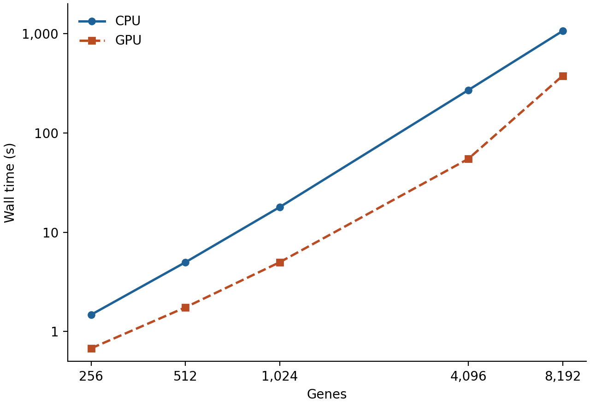

# pidc-cuda

`pidc-cuda` is a standalone Python package for fast PIDC
(Partial Information Decomposition and Context) gene-regulatory-network
scoring. It provides:

- an exact optimized C++/OpenMP CPU aggregation;
- a CUDA pair-profile and sorted-redundancy backend;
- pairwise MI, proportional unique contribution (PUC), and final contextual
  confidence matrices from one call.

The package imports as `pidc_cuda` and has no installed-file overlap with
either `mimiq` or `mimiq_cuda`.

PIDC has its own empirical-state compressor and its own CUDA implementation
in `cpp/pidc_cuda_backend.cu`. It does not include or call the MIMIQ adaptive
MI implementation. Pairwise maximum-likelihood MI is calculated directly as
the first stage required by PIDC.

## Install

Building from source requires a C++20 compiler, CMake 3.24+, Eigen, Boost,
OpenMP, and the CUDA toolkit (including `nvcc`). The installed extension
statically links the CUDA runtime; a compatible NVIDIA driver is still
required to execute `pidc_gpu`.

```bash
python -m pip install .
```

To build a wheel:

```bash
python -m pip install build
python -m build --wheel
python -m pip install dist/pidc_cuda-*.whl
```

The default wheel embeds several CUDA cubins plus PTX for the newest
configured target. A fleet-specific build can override that list:

```bash
CMAKE_ARGS="-DPIDC_CUDA_ARCHITECTURES=80-real;90-real;120" \
  python -m build --wheel
```

`PIDC_PORTABLE_BUILD=ON` is the default and avoids `-march=native`.

## Use

```python
import numpy as np
import pidc_cuda

rng = np.random.default_rng(42)
samples = rng.poisson(3.0, size=(20_000, 1_000)).astype(np.int32)

mi, puc, confidence = pidc_cuda.pidc_gpu(
    samples, max_bins=8, target_batch_size=32
)

# The CPU result uses the same estimator and binning.
mi_cpu, puc_cpu, confidence_cpu = pidc_cuda.pidc_cpu(
    samples, max_bins=8
)
```

PIDC consumes non-negative integer data. Its binning is empirical and does
not require fitted marginal parameters. GPU binning supports
`1 <= max_bins <= 64`. `target_batch_size` trades GPU working memory against
the number of batches.

The optimized CPU aggregation is mathematically equivalent to the explicit
triplet loop. For a small reference calculation, pass
`triplet_reference=True` to `pidc_cpu`; this is much slower and is intended
only for validation.

## Performance

On one million cells, PIDC ran roughly 2–5× as fast on the GPU as on 12 CPU cores, depending on gene count.



## Test

```bash
python -m pytest
```

The suite first verifies the optimized CPU aggregation against the explicit
triplet reference, then compares CUDA with CPU when a GPU is present.

## Platform scope

The initial supported binary target is Linux x86-64 with an NVIDIA GPU.
CUDA is not available on macOS. Python bindings use pybind11 and therefore
produce one wheel per CPython version rather than a stable-ABI wheel.
